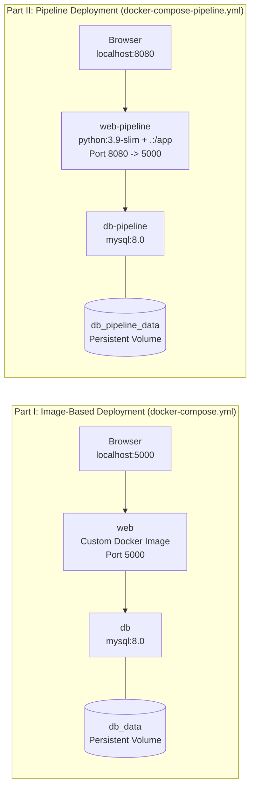

# Flask-MySQL Docker Pipeline

> A containerized Python (Flask) and MySQL visitor-counter web application demonstrating **Docker image-based deployment**, **persistent database storage**, and **bind-mount CI/CD pipeline deployment** running side by side.

---

## Plain-English Summary (For Everyone)

Imagine a simple website that counts how many times people have visited it and remembers that number even if the server restarts.

To make this website work reliably on any computer without complicated setup, this project packages it using **Docker** (think of Docker containers like self-contained shipping boxes that carry everything an app needs to run):

- **The Web App box (`Flask`)**: Shows the web page and adds `+1` to the visit counter every time you refresh.
- **The Database box (`MySQL`)**: Safely stores the visit count. It uses a **persistent volume** (like an external hard drive) so the count is never lost when the containers stop or restart.

This project demonstrates **two different ways** to run the exact same app at the same time without them interfering with each other:

1. **Standard Packaged Deployment (Port `5000`)** — Runs the app from a pre-built Docker image (how apps are typically packaged and shipped via Docker Hub).
2. **CI/CD Pipeline Deployment (Port `8080`)** — Runs the app directly from the source code folder without rebuilding a Docker image, using separate container names, a separate database, and a different port so both environments can run simultaneously.

---

## Key DevOps Concepts Demonstrated (For Reviewers)

| Concept | Implementation in This Repository |
| :--- | :--- |
| **Containerization & Layer Caching** | `Dockerfile` uses `python:3.9-slim`, copies `requirements.txt` before application code so dependency layers are cached, and installs with `--no-cache-dir`. |
| **Multi-Container Orchestration** | `docker-compose.yml` and `docker-compose-pipeline.yml` coordinate a Flask web service and a MySQL 8.0 database service over an internal Docker network. |
| **Data Persistence** | Named Docker volumes (`db_data` and `db_pipeline_data`) are mounted to `/var/lib/mysql` so database state persists across container lifecycles. |
| **Environment Isolation** | Both Compose stacks can run concurrently on the same host by using distinct service names (`web`/`db` vs. `web-pipeline`/`db-pipeline`), separate volumes, and non-overlapping host ports (`5000` vs. `8080`). |
| **Bind-Mount Pipeline Deployment** | `docker-compose-pipeline.yml` mounts the repository directly (`./:/app`) into a base `python:3.9-slim` container and installs dependencies at runtime—no custom `Dockerfile` build step required. |
| **Pipeline Triggering** | `Deployment_Trigger_1776258414.txt` demonstrates a commit-based trigger used to kick off an automated CI/CD deployment pipeline. |
| **Graceful Startup Handling** | `app.py` catches MySQL connection errors (such as while MySQL is still initializing) and returns a helpful status message instead of crashing the request handler. |

---

## Architecture Overview



---

## Project Structure

```text
flask-mysql-docker-pipeline/
├── app.py                            # Flask web app with MySQL visit counter
├── requirements.txt                  # Python dependencies (Flask 3.0.0, mysql-connector-python 8.2.0)
├── Dockerfile                        # Builds the containerized Flask application image
├── docker-compose.yml                # Part I: Image-based deployment (Port 5000) + persistent DB volume
├── docker-compose-pipeline.yml       # Part II: Bind-mount pipeline deployment (Port 8080) + separate DB
├── Deployment_Trigger_1776258414.txt # Empty trigger file committed to initiate CI/CD pipeline runs
└── README.md                         # Project documentation
```

### File-by-File Breakdown

- **`app.py`**:
  - Connects to MySQL using environment variables (`DB_HOST`, `DB_USER`, `DB_PASSWORD`, `DB_NAME`).
  - Handles HTTP `GET /`: creates the `visits` table (`id`, `count`) if it does not exist, increments the visit count for `id = 1`, commits the change, and renders an HTML confirmation showing the total view count.
  - Listens on `0.0.0.0:5000` so it is reachable outside the container.
- **`requirements.txt`**:
  - Pins `Flask==3.0.0` and `mysql-connector-python==8.2.0`.
- **`Dockerfile`**:
  - Uses `python:3.9-slim`, sets `/app` as the working directory, installs Python dependencies, copies the source code, exposes port `5000`, and starts `python app.py`.
- **`docker-compose.yml`** *(Part I)*:
  - Runs `web` (from a Docker Hub image) on host port `5000` and `db` (`mysql:8.0`) with the persistent `db_data` volume.
- **`docker-compose-pipeline.yml`** *(Part II)*:
  - Runs `web-pipeline` (base `python:3.9-slim` with `.:/app` bind mount, installing dependencies and running `app.py` via `command`) on host port `8080` and `db-pipeline` (`mysql:8.0`) with the persistent `db_pipeline_data` volume.
- **`Deployment_Trigger_1776258414.txt`**:
  - An empty marker file committed to trigger automated CI/CD webhooks/pipelines.

---

## Tech Stack

- **Backend**: Python 3.9, Flask `3.0.0`
- **Database**: MySQL `8.0`, `mysql-connector-python` `8.2.0`
- **Containers & Orchestration**: Docker, Docker Compose (`3.8`)

---

## Getting Started (For Developers)

### Prerequisites

- [Docker](https://docs.docker.com/get-docker/) installed and running
- [Docker Compose](https://docs.docker.com/compose/install/) (`docker compose` plugin or `docker-compose`)

### 1. Clone the Repository

```bash
git clone https://github.com/ahsankamran613-svg/flask-mysql-docker-pipeline.git
cd flask-mysql-docker-pipeline
```

---

### 2. Run Part I — Image-Based Deployment (Port `5000`)

Before starting `docker-compose.yml`, build and push the image to your Docker Hub account (or build it locally):

```bash
# Build the Docker image (replace <your-dockerhub-username> with your actual username)
docker build -t <your-dockerhub-username>/my-simple-app:latest .

# Optional: push to Docker Hub
docker push <your-dockerhub-username>/my-simple-app:latest
```

Update line 5 of `docker-compose.yml` to replace the placeholder `yourdockerhubusername/my-simple-app:latest` with your image tag, then start the stack:

```bash
docker compose up -d
```

Open your browser and visit: **http://localhost:5000**

To stop the stack (while keeping the database volume intact):

```bash
docker compose down
```

---

### 3. Run Part II — CI/CD Pipeline Deployment (Port `8080`)

This stack runs directly from the local source code without building a custom image and can run **at the same time** as Part I:

```bash
docker compose -f docker-compose-pipeline.yml up -d
```

Open your browser and visit: **http://localhost:8080**

To stop the pipeline stack:

```bash
docker compose -f docker-compose-pipeline.yml down
```

> **Tip:** To also remove the persistent database volumes and reset the visit counter to `1`, add `-v` (for example, `docker compose down -v`).

---

## Configuration (Environment Variables)

Both `app.py` and the Docker Compose files configure the database connection through environment variables:

| Variable | Default in `app.py` | Part I (`docker-compose.yml`) | Part II (`docker-compose-pipeline.yml`) | Description |
| :--- | :--- | :--- | :--- | :--- |
| `DB_HOST` | `db` | `db` | `db-pipeline` | Hostname of the MySQL container on the Docker network |
| `DB_USER` | `root` | `root` | `root` | MySQL username |
| `DB_PASSWORD` | `rootpassword` | `rootpassword` | `rootpassword` | MySQL password |
| `DB_NAME` | `appdb` | `appdb` | `appdb` | Target MySQL database name |

---

## Comparison: Part I vs. Part II

| Feature | Part I (`docker-compose.yml`) | Part II (`docker-compose-pipeline.yml`) |
| :--- | :--- | :--- |
| **Web Service Name** | `web` | `web-pipeline` |
| **Database Service Name** | `db` | `db-pipeline` |
| **Web Image Source** | Pre-built custom image (`Dockerfile` / Docker Hub) | Stock `python:3.9-slim` + live code bind mount (`.:/app`) |
| **Host Port** | `5000` (`5000:5000`) | `8080` (`8080:5000`) |
| **Database Volume** | `db_data` | `db_pipeline_data` |
| **Best Use Case** | Packaged release / Docker Hub distribution | Automated CI/CD pipeline or rapid code-sync deployment |

---

## Troubleshooting

- **"Database connection failed! Refresh in a few seconds..."**
  - On the very first startup, MySQL 8.0 needs a few seconds to initialize the database. Wait 10–15 seconds and refresh the browser—the app will connect automatically and start counting visits.
- **`pull access denied for yourdockerhubusername/my-simple-app`**
  - In `docker-compose.yml`, replace `yourdockerhubusername/my-simple-app:latest` with your own built/pushed Docker image name (or replace `image:` with `build: .` for local-only testing).
- **Port `5000` or `8080` already in use**
  - Change the left side of the port mapping in the Compose file (e.g., `"5001:5000"` or `"8081:5000"`) and restart with `docker compose up -d`.

---

## Security & Production Note

This project was created as a **DevOps assignment** and uses hardcoded development credentials (`root` / `rootpassword`) and Flask's built-in development server (`app.run(...)`) for simplicity. Before deploying to a production environment:

- Move credentials into a `.env` file (excluded from Git via `.gitignore`) or a secrets manager.
- Use a dedicated non-root MySQL user instead of `root`.
- Serve the Flask app with a production WSGI server such as **Gunicorn**.
